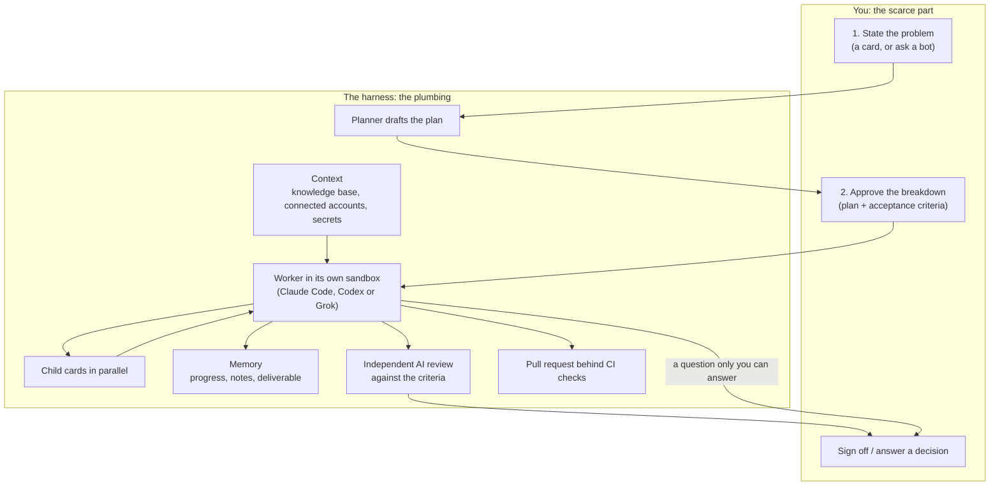

# What Operation Kit is

Operation Kit is a **capable harness for AI work** that runs on a business's own server. You say what
outcome you want. You approve how it gets broken down. The install handles the plumbing: context,
sandboxes, accounts, memory, verification and follow-up.

It is built for the AI implementation consultant who installs one copy per client. Their scarce time
is understanding the client's problem and breaking it down, so that is the only part the product
asks of them. Writing agent files, wiring context and building checks are the harness's job.

If you think in pictures, start with the chart. If you think in words, skip to **The loop**. Tables
and files are in [Data](./07-data.md).

## The loop

1. **State the problem.** Press **New** on the Board, or tell a bot in **Bots** what you want. Write
   the outcome, not the method: "a weekly report of overdue invoices goes to finance every Monday",
   not "build a skill that queries the accounting API".
2. **Approve the breakdown.** A project card starts in **Planning**. A read-only planner reads the card
   and the workspace's knowledge, asks you questions, and drafts a plan with acceptance criteria. You
   answer and edit until it is right, then press **Approve plan**. A smaller task or bug card goes
   straight to the queue.
3. **The harness runs it.** Each card gets one worker session in its own sandbox, on the client's own
   AI account, with the relevant knowledge and connected accounts in reach. It writes progress you
   can read on the card, splits large work into child cards that run side by side, and keeps notes
   that survive a restart. Code changes land as a pull request behind the repo's CI checks.
4. **Check, then sign off.** When the worker finishes, an independent AI reviewer grades the result
   against the approved criteria. A failed review goes back to the worker. A pass closes a task or
   bug card; a project waits in **Needs you** for your sign-off. If the worker needs something only you can decide, it raises one short briefing
   (context, one question, options, a recommendation) instead of stopping with a wall of text.

The **card status is the truth**, not the agent's last sentence: Planning → Queue → Working →
AI review → Needs you → Done (or Retired).

## Who it is for

- **The consultant** installs it for a client and spends their time on the client's workflows.
- **The client's team** each have their own login. Work is grouped into **workspaces** (a team or
  business unit), each with its own board and knowledge folders. A card is assigned to a person, and
  the worker acts as that person for email and GitHub.

## What you see every day

- **Bots**: one ongoing conversation per bot, like a personal assistant. Bots draft emails and
  calendar invites for a person to send, and hand bigger jobs to the board as cards.
- **Board**: the cards, from Planning to Done.
- **Context**: the knowledge base, plain markdown files compiled from the client's own documents.
- **Workflows** (admins): recurring work on a schedule. Every run is a card.
- **Needs you**: the badge in the top bar. One stack of open decisions across bots and cards.
- **Account menu**: Settings (integrations, secrets, models, branding, email), and for admins
  **System** (usage, spend, host health) and **Bot setup**.

## What you do not have to manage

The harness owns these, so a new user can ignore them:

| Plumbing | How the install handles it |
| --- | --- |
| Context | Each card gets the relevant knowledge for its workspace; nothing from another workspace. |
| Accounts and keys | Linked once in **Settings → Integrations** and **Settings → Secrets**. Workers use them by name and never see a value in chat. |
| Sandboxes | Every card runs in its own sandbox and its own copy of the repo, never the live checkout. |
| Verification | Independent AI review plus CI on every code change. |
| Memory | Per-card notes and deliverable; bots can keep their own notes and open loops. |
| Seats | If one AI account hits its limit, work moves to another seat on the same install. |

## Advanced: shaping the install by hand

Agent files, skills and the skill graph are still there, on **Bot setup** in the account menu,
for consultants who want them. You do not need them to get work done. See
[Skills, Tools & Agents](../wiki/Skills-Tools-Agents.md) and the
[agent file format](../agents/agent-file-format.md). The example skills in
`examples/workspace/skills/` are a short prompting library: read them for how to write a clear brief,
rather than installing them as a pack.

## What it is not

- Not a shared cloud. Every client has its own install on its own server.
- Not a shared identity. A card acts as its assigned person for email and git.
- Not a chatbot with a file picker. Anything longer than a few minutes becomes a card with a plan,
  a reviewer and a history.

## One screen of truth

If the Board disagrees with a transcript, trust the Board, then read the session. If a decision is
waiting, it is in **Needs you**. If something went out as the wrong person, check the card's assignee
and that person's **Settings → Integrations**.
